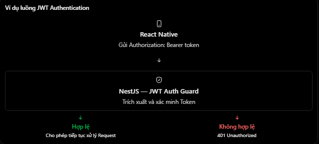

# REST API & HTTP: Authorization, Content-Type và Accept

## Mục lục

- [HTTP request header là gì?](#http-request-header-là-gì)
- [Authorization - Thông tin xác thực](#authorization---thông-tin-xác-thực)
- [Content-Type - Định dạng nội dung đang gửi](#content-type---định-dạng-nội-dung-đang-gửi)
- [Accept - Định dạng client chấp nhận](#accept---định-dạng-client-chấp-nhận)
- [Phân biệt Content-Type và Accept](#phân-biệt-content-type-và-accept)
- [Content negotiation](#content-negotiation)
- [Ví dụ với NestJS](#ví-dụ-với-nestjs)
- [Lưu ý bảo mật và CORS](#lưu-ý-bảo-mật-và-cors)
- [Những lỗi thường gặp](#những-lỗi-thường-gặp)
- [Thực hành](#thực-hành)
- [Câu hỏi ôn tập](#câu-hỏi-ôn-tập)

## HTTP request header là gì?

HTTP request headers là metadata được client gửi cùng request, giúp server hiểu cách xử lý request:

- Client đang cung cấp credential nào?
- Request body có định dạng gì?
- Client chấp nhận response theo định dạng nào?

Ví dụ:

```http
POST /api/v1/users HTTP/1.1
Host: api.example.com
Authorization: Bearer eyJhbGciOi...
Content-Type: application/json
Accept: application/json

{
  "name": "Nhat",
  "email": "nhat@gmail.com"
}
```

Các thành phần:

| Thành phần | Ví dụ | Vai trò |
| --- | --- | --- |
| Request line | `POST /api/v1/users HTTP/1.1` | Method, request target và HTTP version |
| Request headers | `Authorization`, `Content-Type`, `Accept` | Metadata của request |
| Request body | JSON bên dưới dòng trống | Nội dung được gửi tới server |

Tên HTTP header **không phân biệt chữ hoa/chữ thường**. `Content-Type`, `content-type` và `CONTENT-TYPE` có cùng ý nghĩa. Dù vậy, nên dùng cách viết phổ biến để dễ đọc.

## Authorization - Thông tin xác thực

`Authorization` là request header dùng để gửi credential giúp server xác thực request.

Ví dụ với Bearer token:

```http
GET /api/v1/profile
Authorization: Bearer <access_token>
```

Cấu trúc:

| Phần | Ý nghĩa |
| --- | --- |
| `Authorization` | Tên header |
| `Bearer` | Authentication scheme |
| `<access_token>` | Credential/token do authorization server hoặc backend cấp |

Khi backend nhận request, authentication guard/middleware thường:

1. Đọc `Authorization`.
2. Kiểm tra scheme có phải `Bearer` hay không.
3. Trích xuất token.
4. Xác minh chữ ký, thời hạn và các claim cần thiết.
5. Gắn thông tin principal/user đã xác thực vào request.



`Authorization` không chỉ dành cho JWT. Bearer token có thể là JWT hoặc opaque token; HTTP còn có các authentication schemes khác như `Basic` hoặc `Digest`.

> Tên header `Authorization` dễ gây nhầm: nó thường mang credential phục vụ **authentication**. Sau khi xác thực danh tính, server vẫn phải **authorize** xem user có quyền với action/resource hay không. Token hợp lệ không đồng nghĩa có mọi quyền.

Khi credential thiếu hoặc không hợp lệ, server thường trả `401 Unauthorized` cùng `WWW-Authenticate`. Khi đã xác thực nhưng không đủ quyền, server thường trả `403 Forbidden`.

## Content-Type - Định dạng nội dung đang gửi

`Content-Type` mô tả media type của **message body hiện tại**. Trong request:

```http
POST /api/v1/users
Content-Type: application/json

{
  "name": "Nhat",
  "age": 22
}
```

Server biết body cần được parse như JSON. Một số media type thường gặp:

| Content-Type | Mục đích |
| --- | --- |
| `application/json` | Dữ liệu JSON |
| `multipart/form-data; boundary=...` | Upload file và các trường form |
| `application/x-www-form-urlencoded` | Form key-value đã URL-encode |
| `text/plain; charset=utf-8` | Văn bản thuần |
| `application/octet-stream` | Dữ liệu nhị phân tổng quát |

Media type có thể có parameters:

- `charset=utf-8` cho biết character encoding.
- `boundary=...` phân tách các phần trong multipart body.

Nếu API không hỗ trợ media type của request body, status phù hợp thường là `415 Unsupported Media Type`. Nếu body khai báo JSON nhưng JSON sai cú pháp, thường trả `400 Bad Request`.

Ví dụ Axios:

```ts
await axios.post("/api/v1/users", {
  name: "Nhat",
  age: 22,
});
```

Khi gửi JavaScript object dưới dạng JSON, Axios thường tự serialize và đặt `Content-Type` phù hợp. Với `FormData`, nên để HTTP client/browser tự tạo `Content-Type: multipart/form-data` kèm đúng `boundary`; tự đặt thiếu boundary có thể làm server không parse được body.

`Content-Type` cũng xuất hiện trong **response** để mô tả response body:

```http
HTTP/1.1 200 OK
Content-Type: application/json; charset=utf-8

{
  "id": 10,
  "name": "Nhat"
}
```

## Accept - Định dạng client chấp nhận

`Accept` là request header cho biết client chấp nhận response body theo media type nào:

```http
GET /api/v1/users/10
Accept: application/json
```

Nếu server chọn JSON:

```http
HTTP/1.1 200 OK
Content-Type: application/json; charset=utf-8

{
  "id": 10,
  "name": "Nhat"
}
```

Điểm cần nhớ:

- `Accept` nằm trong request và mô tả các response media type client chấp nhận.
- `Content-Type` trong response cho biết media type server thực sự gửi.
- `Accept: */*` nghĩa là client chấp nhận mọi media type.
- Client có thể liệt kê nhiều loại, ví dụ `Accept: application/json, text/plain`.
- Quality value (`q`) thể hiện mức ưu tiên, ví dụ `text/plain; q=0.5`.

Server không bắt buộc hỗ trợ mọi định dạng client yêu cầu. Nếu không thể tạo representation phù hợp với `Accept`, server có thể trả `406 Not Acceptable`.

## Phân biệt Content-Type và Accept

| Tiêu chí | `Content-Type` | `Accept` |
| --- | --- | --- |
| Câu hỏi trả lời | Nội dung đang gửi có định dạng gì? | Client chấp nhận response ở định dạng nào? |
| Trong request | Mô tả request body | Mô tả response mong muốn |
| Trong response | Mô tả response body | Thường không dùng để mô tả body |
| Ví dụ | `application/json` | `application/json, text/plain` |
| Khi không hỗ trợ | Có thể trả `415` | Có thể trả `406` |

Client có thể gửi JSON nhưng muốn nhận plain text:

```http
POST /api/v1/messages
Content-Type: application/json
Accept: text/plain

{
  "message": "Hello"
}
```

Nếu server hỗ trợ:

```http
HTTP/1.1 201 Created
Content-Type: text/plain; charset=utf-8

Message 15 created
```

Tóm lại:

- `Content-Type`: “Nội dung tôi đang gửi là gì?”
- `Accept`: “Tôi có thể nhận nội dung gì?”

Hai header không cần giống nhau.

## Content negotiation

Content negotiation là quá trình server chọn representation phù hợp từ khả năng server và danh sách client chấp nhận.

Ví dụ:

```http
Accept: text/plain; q=0.5, application/json; q=1.0
```

Client ưu tiên JSON hơn plain text. Server hỗ trợ cả hai nên có thể chọn `application/json`.

Một quy trình đơn giản:

1. Parse các media range trong `Accept`.
2. Xét độ cụ thể và quality value `q`.
3. Chọn media type server hỗ trợ.
4. Trả `Content-Type` tương ứng.
5. Nếu không có loại phù hợp, trả `406`.

Khi response thay đổi dựa trên `Accept`, server/cache nên cân nhắc header:

```http
Vary: Accept
```

Header này báo cho cache rằng các giá trị `Accept` khác nhau có thể tạo response khác nhau.

Không phải framework nào cũng tự content negotiate mọi kiểu dữ liệu. Nếu API chỉ hỗ trợ JSON, cần quy định rõ thay vì giả định gửi `Accept: application/xml` sẽ tự tạo XML.

## Ví dụ với NestJS

```ts
@Controller("users")
export class UsersController {
  @Get("me")
  @UseGuards(JwtAuthGuard)
  getProfile(@Req() request: Request) {
    return request.user;
  }
}
```

Client gửi:

```http
GET /api/v1/users/me
Authorization: Bearer <access_token>
Accept: application/json
```

Luồng xử lý:

1. `JwtAuthGuard` đọc `Authorization`.
2. Guard xác minh token và gắn user vào request.
3. Controller trả thông tin user đã xác thực.
4. NestJS serialize kết quả thành JSON theo cấu hình.

NestJS không tự tạo XML chỉ vì client gửi `Accept: application/xml`. Nếu muốn hỗ trợ nhiều representation, ứng dụng phải triển khai negotiation và serialization tương ứng.

Có thể đọc header bằng `@Headers()`:

```ts
@Post("messages")
create(
  @Headers("content-type") contentType: string,
  @Headers("accept") accept: string,
  @Body() dto: CreateMessageDto,
) {
  // Kiểm tra/negotiation theo API contract nếu cần.
}
```

Thông thường body parser, guard và interceptor phù hợp sẽ xử lý các concern này thay vì dồn mọi logic vào controller.

## Lưu ý bảo mật và CORS

- Luôn truyền credential qua HTTPS; header không tự mã hóa token.
- Không ghi toàn bộ `Authorization` hoặc access token vào log.
- Không đặt token trong URL/query string vì URL dễ xuất hiện trong history, log và referrer.
- Token cần được kiểm tra chữ ký, expiration, issuer/audience và trạng thái theo thiết kế hệ thống.
- `Content-Type` chỉ mô tả định dạng; nó không chứng minh body an toàn. Server vẫn phải parse cẩn thận và validation.
- `Accept` không phải cơ chế authorization.

Trong browser, cross-origin request có `Authorization` hoặc `Content-Type: application/json` thường làm phát sinh CORS preflight `OPTIONS`. Server cần cấu hình CORS phù hợp, nhưng CORS không thay thế authentication/authorization.

## Những lỗi thường gặp

| Hiểu nhầm hoặc lỗi | Cách hiểu đúng |
| --- | --- |
| Nhầm `Content-Type` và `Accept` | `Content-Type` mô tả body hiện tại; `Accept` mô tả response chấp nhận |
| `Authorization` luôn chứa JWT | Bearer token có thể không phải JWT; còn có scheme khác |
| Có `Authorization` là đã xác thực | Server vẫn phải xác minh credential |
| Token hợp lệ là có mọi quyền | Sau authentication vẫn cần authorization |
| Mọi `GET` phải có request `Content-Type` | `GET` thông thường không có body nên không cần |
| Tự đặt `multipart/form-data` không có boundary | Nên để HTTP client tạo header kèm boundary |
| Gửi `application/xml` nhưng body là JSON | Header phải phản ánh đúng body thực tế |
| API phải trả đúng mọi giá trị `Accept` | Server chỉ có thể chọn loại hỗ trợ hoặc trả `406` |
| Log header để debug mà không che token | Credential có thể bị lộ qua log |
| Tên header phân biệt hoa/thường | Tên HTTP header không phân biệt chữ hoa/thường |

## Thực hành

Chạy [ví dụ Authorization, Content-Type và Accept](../Example/request-headers-example.js). Ví dụ dùng Node.js có sẵn, kiểm tra Bearer token, từ chối request media type không hỗ trợ bằng `415`, content negotiate JSON/plain text và trả `406` khi không thể đáp ứng `Accept`.

## Câu hỏi ôn tập

1. **HTTP request headers là gì?**
   Là metadata đi cùng request, ví dụ credential, media type của body và định dạng response chấp nhận.

2. **Authorization header dùng làm gì?**
   Nó mang credential theo một authentication scheme, chẳng hạn `Bearer <token>`, để server xác thực request.

3. **Content-Type có nghĩa là gì?**
   Nó mô tả media type của message body hiện tại, ví dụ `application/json`.

4. **Content-Type và Accept khác nhau thế nào?**
   `Content-Type` mô tả body đang gửi; `Accept` mô tả các response media type client chấp nhận.

5. **GET có luôn cần Content-Type không?**
   Không. Request `GET` thông thường không có body nên không cần request `Content-Type`.

6. **Khi nào dùng 415 và 406?**
   `415` khi request body dùng media type server không hỗ trợ; `406` khi server không thể tạo response phù hợp với `Accept`.
