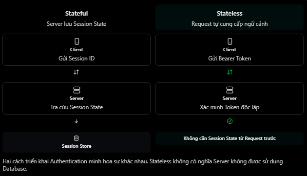
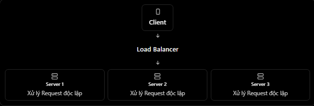

# REST API & HTTP: Stateless

## Mục lục

- [Stateless là gì?](#stateless-là-gì)
- [Stateful và Stateless](#stateful-và-stateless)
- [Stateless có nghĩa server không lưu dữ liệu?](#stateless-có-nghĩa-server-không-lưu-dữ-liệu)
- [Stateless authentication và JWT](#stateless-authentication-và-jwt)
- [Cookie có làm API stateful không?](#cookie-có-làm-api-stateful-không)
- [Vì sao REST yêu cầu stateless?](#vì-sao-rest-yêu-cầu-stateless)
- [Đánh đổi của stateless](#đánh-đổi-của-stateless)
- [Ví dụ với NestJS](#ví-dụ-với-nestjs)
- [Những nhầm lẫn thường gặp](#những-nhầm-lẫn-thường-gặp)
- [Thực hành](#thực-hành)
- [Câu hỏi ôn tập](#câu-hỏi-ôn-tập)

## Stateless là gì?

Trong REST, **stateless** nghĩa là server không lưu client session context giữa các request để hiểu request tiếp theo. Mỗi request phải chứa đủ thông tin cần thiết để server xử lý độc lập.

Ví dụ lấy thông tin cá nhân:

```http
GET /api/v1/users/me
Authorization: Bearer <access_token>
Accept: application/json
```

Server có thể:

1. Nhận request.
2. Lấy credential từ `Authorization`.
3. Xác minh credential.
4. Xác định user và quyền trong request hiện tại.
5. Đọc resource từ database.
6. Trả response.

Request tiếp theo phải cung cấp lại credential/ngữ cảnh cần thiết. Server không mặc định rằng nó thuộc user của request trước.

> “Đủ thông tin” không có nghĩa mọi dữ liệu nghiệp vụ phải nằm trong request. Request có thể chứa ID/credential để server truy vấn resource từ database. Điều bị cấm bởi ràng buộc stateless là phụ thuộc vào **client session context được giữ trên server giữa các request**.

Thông tin tạm thời như `req.user` trong phạm vi một request không vi phạm stateless; nó bị hủy khi request kết thúc và được xây dựng lại cho request sau.

## Stateful và Stateless



| Tiêu chí | Stateful | Stateless |
| --- | --- | --- |
| Client context giữa requests | Server giữ session context | Mỗi request tự mang ngữ cảnh cần thiết |
| Ví dụ xác thực | Session ID tra session trong memory server | Token được xác minh ở mỗi request |
| Khi chuyển server instance | Có thể cần shared session/sticky session | Instance phù hợp nào cũng có thể xử lý |
| Phụ thuộc request trước | Có thể có | Không |
| Scale ngang | Cần giải quyết session distribution | Thường đơn giản hơn |

### Ví dụ stateful session

```http
POST /login

HTTP/1.1 200 OK
Set-Cookie: sessionId=abc123
```

Request sau gửi `sessionId`; server phải tìm session context `abc123` đã lưu. Nếu session chỉ nằm trong memory của server A nhưng request tới server B, B không biết session đó trừ khi dùng sticky session hoặc shared session store.

### Ví dụ stateless request

```http
GET /profile
Authorization: Bearer <signed_token>
```

Server A hoặc B có thể xác minh token bằng cùng khóa/cấu hình rồi xử lý request độc lập.

Stateful không mặc định là sai. Nhiều hệ thống dùng server-side session hợp lý; chúng chỉ không thỏa ràng buộc stateless theo nghĩa REST nghiêm ngặt và cần kiến trúc phân phối session phù hợp.

## Stateless có nghĩa server không lưu dữ liệu?

Không. Đây là nhầm lẫn phổ biến.

| Session state | Resource/application data |
| --- | --- |
| Client context được giữ giữa requests | Dữ liệu nghiệp vụ lâu dài |
| Ví dụ: trạng thái đăng nhập trong memory server | Users, families, orders |
| REST stateless không phụ thuộc vào nó | REST vẫn đọc, tạo, sửa và xóa |

Server stateless vẫn có thể sử dụng:

- PostgreSQL/MySQL để lưu resource.
- Redis để cache resource, rate-limit counter hoặc coordination.
- Object storage để lưu file.
- Message broker để xử lý bất đồng bộ.
- Log, metric và trace.

Ví dụ hệ thống Family Care vẫn có thể lưu:

```text
users
families
family_members
finance_transactions
```

Điểm quan trọng là request hiện tại không cần server nhớ “client này đã làm gì ở request trước” dưới dạng session context để hiểu nó.

Stateless cũng không có nghĩa resource không có trạng thái. Order vẫn có thể chuyển từ `PENDING` sang `PAID`; đó là **resource state**, không phải client session state.

## Stateless authentication và JWT

JWT là cách phổ biến để triển khai stateless authentication vì token có thể mang các claims đã ký:

```json
{
  "sub": "user-123",
  "role": "FAMILY_MEMBER",
  "exp": 1790000000
}
```

Client gửi token ở mỗi request:

```http
GET /api/v1/profile
Authorization: Bearer <access_token>
```

Backend cần xác minh:

- Chữ ký và thuật toán cho phép.
- `exp` và các mốc thời gian.
- `issuer`/`audience` nếu hệ thống dùng.
- Claims/quyền cần thiết.
- Trạng thái user hoặc token nếu chính sách yêu cầu.

JWT không tự động khiến toàn hệ thống stateless:

- Backend vẫn có thể lưu session theo JWT ID và bắt buộc tra session mỗi request.
- Refresh token thường được lưu/hash để rotation và revoke.
- Access-token denylist hoặc token version cần state chung.
- Workflow nhiều bước có thể phụ thuộc server-side conversational state.

Ngược lại, token không cần là JWT mới hỗ trợ kiến trúc phân tán; opaque token có thể được introspect qua một authorization service dùng chung. Tuy nhiên, nếu mỗi request phụ thuộc server-side session context của riêng client thì về mặt REST, đó vẫn là stateful.

> Không tự viết thuật toán token cho production. Dùng thư viện, thuật toán và quy trình quản lý khóa đã được kiểm chứng.

## Cookie có làm API stateful không?

Không nhất thiết. Cookie chỉ là cơ chế browser lưu và tự gửi dữ liệu.

- Cookie chứa session ID, server tra session context: thường stateful.
- Cookie chứa signed/self-contained access token được xác minh độc lập: có thể stateless.

Vì vậy, cần xem **server xử lý giá trị cookie thế nào**, không chỉ xem credential nằm trong cookie hay header.

Khi dùng cookie cho authentication, vẫn phải xử lý `Secure`, `HttpOnly`, `SameSite` và bảo vệ CSRF phù hợp. Khi dùng `Authorization` header, vẫn phải bảo vệ token khỏi XSS/log/storage không an toàn.

## Vì sao REST yêu cầu stateless?

### Khả năng mở rộng



Nếu các instance dùng cùng cấu hình/khóa và truy cập dependency chung, load balancer có thể gửi request tới bất kỳ instance phù hợp nào mà không cần giữ client trên một server cụ thể.

### Reliability và phục hồi

Khi server A hỏng, request mới có thể được server B xử lý mà không mất session context chỉ nằm trong memory của A.

### Visibility

Request chứa ngữ cảnh cần thiết nên middleware, gateway và server dễ hiểu/quan sát request độc lập hơn.

### Giảm coupling giữa requests

Request hiện tại không cần biết request trước được xử lý ở server nào.

Stateless không tự giải quyết mọi bài toán scale. Database, cache, rate limit, khóa, queue và các dependency khác vẫn phải được thiết kế cho tải, tính nhất quán và lỗi.

## Đánh đổi của stateless

| Lợi ích | Đánh đổi |
| --- | --- |
| Dễ scale ngang | Request có thể phải gửi credential/ngữ cảnh lặp lại |
| Không cần sticky session | Token/header có thể lớn hơn session ID |
| Instance dễ thay thế | Thu hồi self-contained token trước hạn khó hơn |
| Request độc lập | Server phải xác minh credential mỗi request |
| Failure isolation tốt hơn | Client phải quản lý state/flow cần thiết |

Không nên nhồi toàn bộ dữ liệu user/quyền thay đổi thường xuyên vào token dài hạn. Claims có thể cũ cho đến khi token hết hạn; nên dùng access token ngắn hạn và chiến lược refresh/revoke phù hợp.

Stateless không đồng nghĩa idempotent:

- Stateless nói về việc server có giữ client session context giữa requests hay không.
- Idempotent nói về hiệu ứng của việc gửi lặp lại cùng một request.

`POST /orders` có thể stateless nhưng không idempotent.

## Ví dụ với NestJS

```ts
@Controller("users")
export class UsersController {
  constructor(private readonly usersService: UsersService) {}

  @UseGuards(JwtAuthGuard)
  @Get("me")
  getProfile(@Req() request: RequestWithUser) {
    return this.usersService.findOne(request.user.id);
  }
}
```

Trong mỗi request:

1. `JwtAuthGuard` đọc credential.
2. Guard xác minh token.
3. Guard gắn principal vào context request hiện tại.
4. Service đọc user resource từ database.
5. Context request được giải phóng khi response hoàn tất.

Không nên dựa vào biến global như `currentUser`:

```ts
// Sai: nhiều requests/users có thể ghi đè lẫn nhau.
let currentUser: User | undefined;
```

Dữ liệu theo request phải nằm trong request context hoặc cơ chế request-scoped phù hợp.

## Những nhầm lẫn thường gặp

| Nhận định | Đánh giá | Giải thích |
| --- | --- | --- |
| Stateless nghĩa là server không dùng database | Sai | Database lưu resource/application data |
| Mỗi request phải có đủ ngữ cảnh xử lý | Đúng | Không phụ thuộc client session context trước đó |
| Stateless cấm Redis/cache | Sai | Có thể dùng nếu không biến thành session context bắt buộc |
| JWT đồng nghĩa API chắc chắn stateless | Sai | Phụ thuộc cách backend quản lý phiên |
| Cookie luôn làm API stateful | Sai | Phụ thuộc nội dung cookie và cách server xử lý |
| Stateless giúp scale ngang | Đúng trong nhiều trường hợp | Giảm nhu cầu sticky/local session |
| Stateless nghĩa resource không có state | Sai | Resource state khác session state |
| Stateless đồng nghĩa idempotent | Sai | Đây là hai thuộc tính khác nhau |
| `req.user` vi phạm stateless | Sai | Context tạm thời trong một request là hợp lệ |

## Thực hành

Chạy [ví dụ Stateful và Stateless](../Example/stateless-example.js). Ví dụ dùng Node.js có sẵn để mô phỏng server A/B: session lưu cục bộ ở A không dùng được tại B, trong khi signed token mang đủ ngữ cảnh có thể được cả hai server xác minh.

## Câu hỏi ôn tập

1. **Stateless trong REST có nghĩa gì?**
   Mỗi request chứa đủ ngữ cảnh cần thiết và server không phụ thuộc client session context đã lưu từ request trước.

2. **Stateless có nghĩa server không lưu dữ liệu không?**
   Không. Server vẫn lưu và truy vấn resource/application data trong database, cache hoặc storage.

3. **JWT hỗ trợ stateless authentication thế nào?**
   Token có claims đã ký để server xác minh mỗi request mà không cần session context cục bộ từ request trước.

4. **Dùng JWT có chắc chắn làm API stateless không?**
   Không. Cách backend quản lý session, revoke và workflow mới quyết định.

5. **Vì sao stateless giúp scale ngang?**
   Request có thể được instance phù hợp bất kỳ xử lý mà không cần session chỉ tồn tại ở một instance.

6. **Cookie có luôn làm API stateful không?**
   Không. Cookie chứa session ID thường dẫn tới server-side session; cookie chứa token tự xác minh có thể vẫn stateless.

7. **Stateless khác idempotent thế nào?**
   Stateless nói về session context giữa requests; idempotent nói về hiệu ứng khi lặp lại cùng request.
