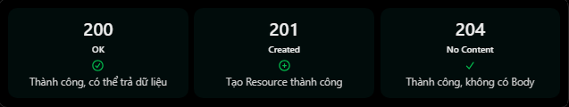

# REST API & HTTP: Status Code 200, 201 và 204

## Mục lục

- [HTTP status code là gì?](#http-status-code-là-gì)
- [200 OK](#200-ok)
- [201 Created](#201-created)
- [204 No Content](#204-no-content)
- [So sánh 200, 201 và 204](#so-sánh-200-201-và-204)
- [Ví dụ với NestJS](#ví-dụ-với-nestjs)
- [Ví dụ với ExpressJS](#ví-dụ-với-expressjs)
- [Chọn status code theo kết quả](#chọn-status-code-theo-kết-quả)
- [Những lỗi thường gặp](#những-lỗi-thường-gặp)
- [Thực hành](#thực-hành)
- [Câu hỏi ôn tập](#câu-hỏi-ôn-tập)

## HTTP status code là gì?

HTTP status code là mã trạng thái được server trả về trong HTTP response, giúp client biết kết quả xử lý request.

Ví dụ client gửi:

```http
GET /api/v1/users/10
```

Server trả về:

```http
HTTP/1.1 200 OK
Content-Type: application/json

{
  "id": 10,
  "name": "Nhat"
}
```

Trong response này:

- `200` là status code.
- `OK` là reason phrase; client nên dựa vào code thay vì nội dung phrase.
- JSON là response body chứa representation của resource.

Chữ số đầu tiên cho biết nhóm kết quả:

| Nhóm | Ý nghĩa tổng quát |
| --- | --- |
| `1xx` | Thông tin tạm thời |
| `2xx` | Request đã được xử lý thành công |
| `3xx` | Chuyển hướng hoặc cần hành động thêm |
| `4xx` | Lỗi phía client/request |
| `5xx` | Server không hoàn thành được request |

Bài này tập trung vào ba mã thành công phổ biến: `200`, `201` và `204`.

## 200 OK

`200 OK` nghĩa là request đã được xử lý thành công. Đây là status code phổ biến khi API trả dữ liệu cho client:

```http
GET /api/v1/users/10
```

```http
HTTP/1.1 200 OK
Content-Type: application/json

{
  "id": 10,
  "name": "Nhat",
  "email": "nhat@gmail.com"
}
```

Những trường hợp thường dùng `200`:

- `GET` lấy collection hoặc resource thành công.
- `PUT` hoặc `PATCH` cập nhật thành công và trả resource sau cập nhật.
- `DELETE` thành công và trả thông tin xác nhận.
- `POST` xử lý một action thành công nhưng không tạo resource, ví dụ đăng nhập.

`200` không chỉ dành cho `GET`. Với `GET`, response `200` thường chứa representation; với các method khác, body phụ thuộc API contract.

## 201 Created

`201 Created` nghĩa là request đã thành công và tạo ra một hoặc nhiều resource mới.

```http
POST /api/v1/users
Content-Type: application/json

{
  "name": "Nhat",
  "email": "nhat@gmail.com"
}
```

Response:

```http
HTTP/1.1 201 Created
Location: /api/v1/users/15
Content-Type: application/json

{
  "id": 15,
  "name": "Nhat",
  "email": "nhat@gmail.com"
}
```

Response cho biết:

- User đã được tạo thành công.
- Resource mới có ID `15`.
- Header `Location` trỏ đến URI của resource vừa tạo.
- Body có thể chứa representation của resource mới.

`201` không bắt buộc phải có JSON body. Khi một resource chính được tạo, response nên cung cấp URI của resource đó qua `Location` hoặc URI hiệu lực của request nếu chính URI ấy nhận diện resource mới.

`201` thường đi cùng `POST` tạo resource, nhưng không bị giới hạn ở `POST`. Ví dụ `PUT` có thể trả `201` nếu API cho phép tạo resource mới tại URI do client chỉ định.

## 204 No Content

`204 No Content` nghĩa là server đã xử lý request thành công và response **không có nội dung body**.

```http
DELETE /api/v1/users/15
```

```http
HTTP/1.1 204 No Content
```

`204` thường được dùng khi:

- `DELETE` thành công và client không cần dữ liệu trả về.
- `PUT` hoặc `PATCH` thành công nhưng server không trả representation sau cập nhật.
- Một action hoàn tất thành công mà không có nội dung cần gửi.

Response `204` không được chứa message hoặc JSON body. Metadata trong header vẫn có thể xuất hiện. Nếu muốn trả:

```json
{
  "message": "User deleted successfully"
}
```

thì nên dùng `200 OK` thay vì `204 No Content`.

Client không nên cố parse JSON từ response `204`; hãy kiểm tra status trước vì body rỗng là hành vi đúng.

## So sánh 200, 201 và 204



| Tiêu chí | `200 OK` | `201 Created` | `204 No Content` |
| --- | --- | --- | --- |
| Ý nghĩa | Xử lý thành công | Xử lý thành công và tạo resource | Xử lý thành công, không trả nội dung |
| Response body | Thường có, tùy method | Có thể có | Không được có |
| Header `Location` | Không đặc trưng | Nên có khi nhận diện được resource mới | Không đặc trưng |
| Ví dụ phổ biến | `GET /users/10` | `POST /users` | `DELETE /users/10` |
| Client parse JSON | Khi `Content-Type` và contract cho biết có JSON | Nếu response có JSON | Không |

Cách ghi nhớ:

- `200`: thành công, thường có kết quả trả về.
- `201`: thành công và đã tạo resource.
- `204`: thành công nhưng không có response body.

## Ví dụ với NestJS

```ts
@Controller("users")
export class UsersController {
  constructor(private readonly usersService: UsersService) {}

  // Mặc định 200 OK
  @Get(":id")
  findOne(@Param("id") id: string) {
    return this.usersService.findOne(id);
  }

  // Mặc định 201 Created
  @Post()
  create(@Body() dto: CreateUserDto) {
    return this.usersService.create(dto);
  }

  // Ghi đè thành 204 No Content
  @Delete(":id")
  @HttpCode(HttpStatus.NO_CONTENT)
  async remove(@Param("id") id: string): Promise<void> {
    await this.usersService.remove(id);
  }
}
```

Mặc định thường gặp trong NestJS:

| Decorator | Status code mặc định |
| --- | --- |
| `@Get()` | `200 OK` |
| `@Post()` | `201 Created` |
| `@Put()` | `200 OK` |
| `@Patch()` | `200 OK` |
| `@Delete()` | `200 OK` |

Muốn `DELETE` trả `204`, khai báo:

```ts
@HttpCode(HttpStatus.NO_CONTENT)
```

`await` bảo đảm thao tác xóa hoàn tất trước khi handler kết thúc. Service cũng cần ném exception phù hợp nếu không tìm thấy resource; không nên trả `204` khi thao tác thực tế thất bại.

## Ví dụ với ExpressJS

Trong ExpressJS, chủ động đặt status code qua `res.status()`:

```js
// 200 OK
app.get("/users/:id", async (req, res) => {
  const user = await findUser(req.params.id);
  return res.status(200).json(user);
});

// 201 Created
app.post("/users", async (req, res) => {
  const user = await createUser(req.body);
  return res
    .status(201)
    .location("/users/" + user.id)
    .json(user);
});

// 204 No Content
app.delete("/users/:id", async (req, res) => {
  await deleteUser(req.params.id);
  return res.status(204).end();
});
```

- `res.status(200).json()` trả JSON cùng `200`.
- `res.status(201).location().json()` trả `201`, header `Location` và resource mới.
- `res.status(204).end()` kết thúc response không có body.

Express không tự chọn `201` chỉ vì route dùng `POST`. Nếu không đặt status khác, response thông thường giữ status mặc định `200`.

## Chọn status code theo kết quả

Status code mô tả **kết quả thực tế**, không chỉ dựa vào HTTP method:

| Tình huống | Status phù hợp |
| --- | --- |
| Lấy user thành công và trả JSON | `200 OK` |
| Đăng nhập thành công và trả token | `200 OK` |
| Tạo user mới thành công | `201 Created` |
| Cập nhật thành công và trả user mới nhất | `200 OK` |
| Cập nhật thành công, không trả body | `204 No Content` |
| Xóa thành công, không trả body | `204 No Content` |
| Không tìm thấy user | `404 Not Found`, không phải `2xx` |
| Body không hợp lệ | `400 Bad Request` hoặc mã `4xx` phù hợp |

Không nên luôn trả `200` rồi đặt lỗi trong JSON như `{ "success": false }`. Client, proxy và công cụ quan sát dựa vào status code để hiểu kết quả ở tầng HTTP.

## Những lỗi thường gặp

| Lỗi hoặc hiểu nhầm | Cách hiểu đúng |
| --- | --- |
| `POST` tạo user nhưng luôn trả `200` | `200` vẫn là thành công, nhưng `201` mô tả chính xác việc resource đã được tạo |
| Trả `204` kèm JSON | `204` không được có response body; dùng `200` nếu muốn trả JSON |
| Client luôn gọi `response.json()` | Với `204`, body rỗng; cần kiểm tra status trước |
| `DELETE` bắt buộc trả `204` | Có thể trả `200` nếu API muốn gửi response body |
| `201` chỉ dùng với `POST` | `201` mô tả kết quả tạo resource, không bị giới hạn tuyệt đối theo method |
| `201` bắt buộc có JSON body | Body là tùy chọn; `Location` và contract giúp client tìm resource mới |
| Thành công luôn là `200` | Nhóm `2xx` có nhiều mã thể hiện các kết quả thành công khác nhau |
| Trả `204` dù thao tác chưa hoàn tất | Chỉ trả success sau khi thao tác cần thiết đã thành công |

## Thực hành

Chạy [ví dụ status code 200, 201 và 204](../Example/status-code-200-201-204-example.js). Ví dụ dùng Node.js có sẵn và dữ liệu trong bộ nhớ, minh họa `200` có JSON, `201` kèm `Location`, `204` không có body và `404` sau khi resource bị xóa.

## Câu hỏi ôn tập

1. **HTTP status code 200 nghĩa là gì?**
   Request đã được server xử lý thành công; response body phụ thuộc method và API contract.

2. **200 và 201 khác nhau thế nào?**
   `200` biểu thị xử lý thành công nói chung; `201` cho biết request thành công và đã tạo resource mới.

3. **Khi nào nên dùng 204 No Content?**
   Khi request thành công và server không cần trả response body.

4. **Response 201 có thể chứa JSON body không?**
   Có. Body có thể chứa representation của resource mới, nhưng không bắt buộc.

5. **Response 204 có thể chứa JSON body không?**
   Không. `204 No Content` không được chứa response body.

6. **Status mặc định cho POST trong NestJS là gì?**
   NestJS mặc định trả `201 Created` cho handler `@Post()`, trừ khi status code được ghi đè.
