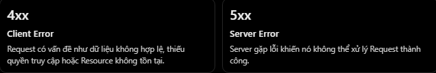
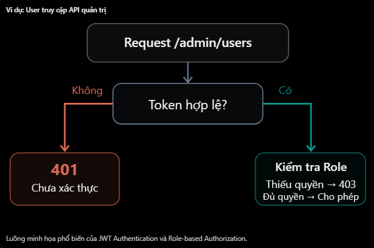

# REST API & HTTP: Status Code 400, 401, 403, 404, 409 và 500

## Mục lục

- [HTTP error status code là gì?](#http-error-status-code-là-gì)
- [400 Bad Request](#400-bad-request)
- [401 Unauthorized](#401-unauthorized)
- [403 Forbidden](#403-forbidden)
- [404 Not Found](#404-not-found)
- [409 Conflict](#409-conflict)
- [500 Internal Server Error](#500-internal-server-error)
- [Bảng tổng hợp](#bảng-tổng-hợp)
- [Phân biệt các status code dễ nhầm](#phân-biệt-các-status-code-dễ-nhầm)
- [Thiết kế error response](#thiết-kế-error-response)
- [Áp dụng trong NestJS](#áp-dụng-trong-nestjs)
- [Những lỗi thường gặp](#những-lỗi-thường-gặp)
- [Thực hành](#thực-hành)
- [Câu hỏi ôn tập](#câu-hỏi-ôn-tập)

## HTTP error status code là gì?

HTTP error status code cho biết request không được xử lý thành công:



| Nhóm | Ý nghĩa tổng quát |
| --- | --- |
| `4xx` | Request, credential hoặc quyền của client không đáp ứng API contract |
| `5xx` | Server gặp lỗi hoặc không thể hoàn thành một request hợp lệ |

`4xx` không nhất thiết có nghĩa frontend viết code sai. Nó cho biết request hiện tại không thể được đáp ứng theo điều kiện của API. Ví dụ token có thể đã hết hạn hoặc resource đã bị xóa.

Status code chỉ mô tả kết quả ở tầng HTTP. Response body nên bổ sung thông báo an toàn, dễ xử lý, nhưng không thay thế status code.

## 400 Bad Request

`400 Bad Request` nghĩa là server không thể hoặc không muốn xử lý request do request không đúng API contract. Các nguyên nhân thường gặp:

- JSON sai cú pháp.
- Thiếu trường bắt buộc.
- Kiểu hoặc định dạng dữ liệu không hợp lệ.
- Path/query parameter sai định dạng.

Ví dụ:

```http
POST /api/v1/users
Content-Type: application/json

{
  "email": "not-an-email",
  "age": -5
}
```

Nếu API yêu cầu email hợp lệ và tuổi không âm:

```http
HTTP/1.1 400 Bad Request
Content-Type: application/json

{
  "statusCode": 400,
  "error": "Bad Request",
  "message": "email không hợp lệ; age phải là số không âm"
}
```

Trong NestJS:

```ts
export class CreateUserDto {
  @IsEmail()
  email: string;

  @Min(0)
  age: number;
}
```

`ValidationPipe` mặc định có thể trả `400` khi dữ liệu không đạt validation rules. Một số API dùng `422 Unprocessable Content` cho dữ liệu đúng cú pháp nhưng sai validation; hãy chọn convention và dùng nhất quán.

## 401 Unauthorized

`401 Unauthorized` nghĩa là request thiếu credential xác thực hợp lệ. Dù tên là “Unauthorized”, mã này chủ yếu liên quan đến **authentication**:

```http
GET /api/v1/profile
Authorization: Bearer invalid-token
```

Response:

```http
HTTP/1.1 401 Unauthorized
WWW-Authenticate: Bearer
Content-Type: application/json

{
  "statusCode": 401,
  "error": "Unauthorized",
  "message": "Access token thiếu, hết hạn hoặc không hợp lệ"
}
```

Tình huống thường gặp:

- Không gửi access token.
- Token hết hạn.
- Token sai chữ ký hoặc sai định dạng.
- Credential không được server chấp nhận.

Response `401` phải kèm challenge `WWW-Authenticate` phù hợp với cơ chế xác thực. Với Bearer token, server có thể thêm thông tin lỗi theo chuẩn áp dụng, nhưng không nên tiết lộ dữ liệu nhạy cảm.

Trong NestJS, authentication guard thường từ chối request chưa được xác thực hợp lệ bằng `UnauthorizedException`.

## 403 Forbidden

`403 Forbidden` nghĩa là server hiểu request nhưng từ chối cho phép thực hiện. Tình huống điển hình là user đã đăng nhập nhưng không đủ quyền:

```http
DELETE /api/v1/admin/users/10
Authorization: Bearer valid-user-token
```

```http
HTTP/1.1 403 Forbidden
Content-Type: application/json

{
  "statusCode": 403,
  "error": "Forbidden",
  "message": "Bạn không có quyền thực hiện hành động này"
}
```

Roles guard hoặc policy/permission guard có thể trả `403` sau khi authentication thành công. HTTP không bắt buộc mọi response `403` chỉ dành cho user đã đăng nhập, nhưng đây là cách phân biệt thực dụng thường dùng trong API:

- `401`: chưa xác thực được client.
- `403`: đã nhận diện client nhưng không cho phép hành động.

## 404 Not Found

`404 Not Found` nghĩa là server không tìm thấy resource tương ứng, không có route phù hợp, hoặc không muốn tiết lộ resource có tồn tại:

```http
GET /api/v1/users/9999
```

Trong NestJS:

```ts
@Get(":id")
async findOne(@Param("id", ParseIntPipe) id: number) {
  const user = await this.usersService.findOne(id);

  if (!user) {
    throw new NotFoundException("User not found");
  }

  return user;
}
```

Phân biệt:

- `GET /users/abc` khi ID phải là số: thường là `400`.
- `GET /users/9999` với ID hợp lệ nhưng user không tồn tại: `404`.
- `GET /users` thành công nhưng collection rỗng: thường là `200 OK` với `[]`, không phải `404`.

Để tránh lộ thông tin, server đôi khi trả `404` thay vì `403` cho resource bí mật mà client không được phép biết tồn tại.

## 409 Conflict

`409 Conflict` nghĩa là request xung đột với trạng thái hiện tại của resource hoặc hệ thống.

Giả sử email có unique constraint và đã tồn tại:

```http
POST /api/v1/users
Content-Type: application/json

{
  "email": "nhat@gmail.com"
}
```

Server có thể trả:

```http
HTTP/1.1 409 Conflict
Content-Type: application/json

{
  "statusCode": 409,
  "error": "Conflict",
  "message": "Email đã tồn tại"
}
```

Các trường hợp thường gặp:

- Vi phạm unique constraint.
- Cập nhật dựa trên phiên bản resource đã cũ.
- Chuyển trạng thái không hợp lệ, ví dụ hủy đơn hàng đã giao.

Với Prisma, unique constraint violation thường có code `P2002`. Backend có thể bắt đúng lỗi đã biết và chuyển thành `409 Conflict`. Không nên biến mọi lỗi database thành `409`.

## 500 Internal Server Error

`500 Internal Server Error` nghĩa là server gặp lỗi bất ngờ khiến request không thể hoàn tất:

- Bug hoặc exception chưa được phân loại.
- Lỗi xử lý nội bộ ngoài dự kiến.
- Lỗi truy cập dependency/database chưa được ánh xạ sang status phù hợp.

Response gửi client nên an toàn:

```http
HTTP/1.1 500 Internal Server Error
Content-Type: application/json

{
  "statusCode": 500,
  "error": "Internal Server Error",
  "message": "Đã xảy ra lỗi ngoài dự kiến",
  "requestId": "req-abc123"
}
```

Không trả stack trace, câu SQL, secret, đường dẫn nội bộ hoặc chi tiết database cho client. Server nên:

1. Ghi log chi tiết lỗi ở hệ thống nội bộ.
2. Gắn request/correlation ID để tra cứu.
3. Trả thông báo chung, an toàn cho client.
4. Giữ nguyên `4xx` đã xác định thay vì biến tất cả lỗi thành `500`.

`500` không có nghĩa client chắc chắn nên retry. Nếu dịch vụ tạm thời không sẵn sàng, `503 Service Unavailable` có thể phù hợp hơn và có thể đi kèm `Retry-After`.

## Bảng tổng hợp

| Status | Tên | Tình huống phổ biến | Client thường làm gì? |
| --- | --- | --- | --- |
| `400` | Bad Request | Body/parameter không hợp lệ | Sửa dữ liệu request |
| `401` | Unauthorized | Credential thiếu, hết hạn hoặc sai | Đăng nhập/làm mới token |
| `403` | Forbidden | Không đủ quyền | Không retry nếu quyền không đổi |
| `404` | Not Found | Resource/route không tồn tại | Kiểm tra ID hoặc điều hướng |
| `409` | Conflict | Trùng unique hoặc xung đột state | Cập nhật dữ liệu rồi thử lại |
| `500` | Internal Server Error | Lỗi server ngoài dự kiến | Báo lỗi; retry tùy contract |

## Phân biệt các status code dễ nhầm

### 401 và 403



- `401`: “Bạn là ai?” — credential thiếu hoặc không hợp lệ.
- `403`: “Bạn không được phép” — server từ chối action/resource.

### 400, 404 và 409

| Tình huống | Status thường dùng |
| --- | --- |
| Email sai định dạng | `400 Bad Request` |
| ID trong URL sai kiểu | `400 Bad Request` |
| ID hợp lệ nhưng resource không tồn tại | `404 Not Found` |
| Email hợp lệ nhưng đã tồn tại | `409 Conflict` |
| State transition xung đột trạng thái hiện tại | `409 Conflict` |

Đây là convention phổ biến, không phải mọi API bắt buộc ánh xạ validation giống hệt nhau. API contract cần ghi rõ và nhất quán.

### 400 và 500

- `400`: request không đáp ứng contract; client cần thay đổi request.
- `500`: server gặp lỗi bất ngờ khi xử lý; không đổ chi tiết nội bộ cho client.

## Thiết kế error response

Nên dùng một cấu trúc nhất quán để frontend dễ xử lý:

```json
{
  "statusCode": 400,
  "error": "Bad Request",
  "message": "Dữ liệu không hợp lệ",
  "details": [
    {
      "field": "email",
      "message": "email phải đúng định dạng"
    }
  ],
  "requestId": "req-abc123"
}
```

Gợi ý:

- `statusCode` khớp status ở HTTP response.
- `message` an toàn và hữu ích với client.
- `details` mô tả lỗi từng trường nếu phù hợp.
- `requestId` giúp đối chiếu log.
- Không buộc mọi lỗi phải có cùng `details`, nhưng các trường chung nên ổn định.
- Không đưa stack trace hay dữ liệu nhạy cảm vào response production.

## Áp dụng trong NestJS

NestJS cung cấp các exception classes tương ứng:

```ts
throw new BadRequestException("Invalid input");
throw new UnauthorizedException("Authentication required");
throw new ForbiddenException("Permission denied");
throw new NotFoundException("User not found");
throw new ConflictException("Email already exists");
throw new InternalServerErrorException();
```

Ví dụ trong service:

```ts
async findOne(id: number) {
  const user = await this.prisma.user.findUnique({
    where: { id },
  });

  if (!user) {
    throw new NotFoundException("User not found");
  }

  return user;
}
```

Không nên trả `500` cho tất cả lỗi. Lỗi đã biết cần được ánh xạ sang status phù hợp; lỗi chưa biết nên được log và để global exception filter trả response `500` an toàn.

## Những lỗi thường gặp

| Lỗi hoặc hiểu nhầm | Cách hiểu đúng |
| --- | --- |
| User thiếu role admin thì trả `401` | Nếu đã xác thực nhưng thiếu quyền, thường trả `403` |
| Token hết hạn thì trả `403` | Credential không còn hợp lệ thường trả `401` |
| `401` không có `WWW-Authenticate` | Response `401` cần challenge xác thực phù hợp |
| Không tìm thấy user thì trả `500` | Đây thường là `404` |
| Body validation sai thì trả `500` | Thường là `400` hoặc `422` theo contract |
| Collection rỗng thì trả `404` | Thường trả `200` cùng mảng rỗng |
| Mọi lỗi database đều là `409` | Chỉ conflict đã biết mới nên ánh xạ `409` |
| Trả stack trace cùng `500` | Ghi log nội bộ và trả thông báo an toàn |
| Luôn trả `200` với `success: false` | Dùng đúng HTTP status để client và hạ tầng hiểu kết quả |

## Thực hành

Chạy [ví dụ các error status code](../Example/status-code-error-example.js). Ví dụ dùng Node.js có sẵn và dữ liệu trong bộ nhớ, cung cấp endpoint tái hiện `400`, `401`, `403`, `404`, `409` và `500` với error response nhất quán.

## Câu hỏi ôn tập

1. **400 Bad Request có nghĩa là gì?**
   Request không đúng API contract, chẳng hạn JSON sai cú pháp hoặc dữ liệu validation không hợp lệ.

2. **401 và 403 khác nhau thế nào?**
   `401` cho biết credential thiếu/không hợp lệ; `403` cho biết server từ chối quyền thực hiện.

3. **Khi nào nên trả 404 Not Found?**
   Khi resource hoặc route không tồn tại, hoặc server không muốn tiết lộ resource có tồn tại.

4. **Khi nào nên trả 409 Conflict?**
   Khi request xung đột với trạng thái hiện tại, ví dụ email unique đã tồn tại.

5. **500 Internal Server Error có nghĩa là gì?**
   Server gặp lỗi ngoài dự kiến và không thể hoàn thành request.

6. **Vì sao không nên trả chi tiết exception trong response 500?**
   Vì stack trace, database hoặc đường dẫn nội bộ có thể làm lộ thông tin nhạy cảm; chi tiết nên được ghi log phía server.
