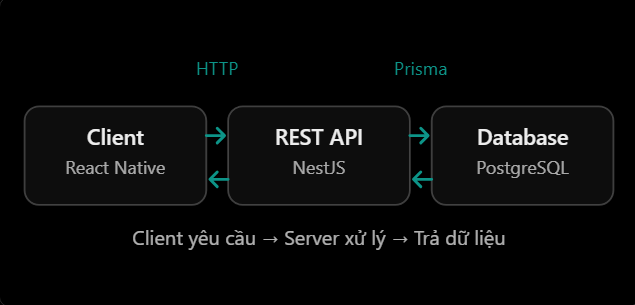

# REST API & HTTP: REST và Resource

## Mục lục

- [REST là gì?](#rest-là-gì)
- [Resource là gì?](#resource-là-gì)
- [Resource và Representation](#resource-và-representation)
- [Thiết kế RESTful API](#thiết-kế-restful-api)
- [Ví dụ với NestJS và Prisma](#ví-dụ-với-nestjs-và-prisma)
- [Các ràng buộc của REST](#các-ràng-buộc-của-rest)
- [Những nhầm lẫn thường gặp](#những-nhầm-lẫn-thường-gặp)
- [Thực hành](#thực-hành)
- [Câu hỏi ôn tập](#câu-hỏi-ôn-tập)

## REST là gì?

REST (*Representational State Transfer*) là một **phong cách kiến trúc** để thiết kế hệ thống phân tán, đặc biệt phổ biến khi xây dựng Web API. REST không phải là ngôn ngữ lập trình, framework hay giao thức.

REST tổ chức việc giao tiếp giữa client và server xoay quanh các **resource** (tài nguyên), thông qua một giao diện thống nhất. HTTP thường được dùng để triển khai REST API, nhưng REST không đồng nghĩa với HTTP.

Ví dụ trong một hệ thống quản lý gia đình:

- Client: ReactJS hoặc React Native.
- Server: NestJS.
- Database: PostgreSQL.
- API: cho phép client truy cập và thao tác với dữ liệu gia đình.



Ví dụ client muốn lấy thông tin gia đình có ID `42`:

```http
GET /api/v1/families/42
```

Server có thể trả về JSON sau:

```json
{
  "id": "42",
  "name": "My Family",
  "memberCount": 4
}
```

Đây là một cách thiết kế API theo hướng REST: URL nhận diện tài nguyên, còn HTTP method thể hiện ý định đọc dữ liệu.

## Resource là gì?

Resource (tài nguyên) là đối tượng hoặc khái niệm mà hệ thống cung cấp để client truy cập và thao tác. Resource có thể là `user`, `family`, `product`, `order` hoặc `family member`.

Mỗi resource được nhận diện bằng một URI. Trong HTTP API, URI thường xuất hiện dưới dạng đường dẫn URL:

| Endpoint | Resource được nhận diện |
| --- | --- |
| `/users` | Tập hợp người dùng |
| `/users/10` | Người dùng có ID `10` |
| `/families` | Tập hợp gia đình |
| `/families/42` | Gia đình có ID `42` |
| `/families/42/members` | Các thành viên của gia đình `42` |

> Resource không nhất thiết tương ứng một bảng database. Ví dụ, resource `Family` có thể được tổng hợp từ nhiều bảng PostgreSQL. REST quan tâm đến contract mà API cung cấp cho client, không buộc client biết cấu trúc dữ liệu nội bộ.

## Resource và Representation

| Khái niệm | Ý nghĩa |
| --- | --- |
| **Resource** | Tài nguyên được nhận diện, ví dụ family có ID `42`. |
| **Representation** | Dữ liệu mô tả resource được gửi trong request/response, ví dụ JSON hoặc XML. |

```http
GET /families/42
```

Ở request trên, resource là family có ID `42`; response bên dưới là một representation của resource đó:

```json
{
  "id": "42",
  "name": "My Family"
}
```

JSON là định dạng representation phổ biến, nhưng REST không bắt buộc chỉ sử dụng JSON. Cùng một resource về nguyên tắc có thể có representation khác tùy vào nội dung mà server và client thỏa thuận, chẳng hạn JSON hoặc XML.

## Thiết kế RESTful API

### Dùng danh từ cho đường dẫn resource

URL nên nhận diện resource; HTTP method thường thể hiện hành động. Vì vậy, với CRUD, ưu tiên danh từ trong đường dẫn:

| Không khuyến khích | Khuyến khích |
| --- | --- |
| `GET /getUsers` | `GET /users` |
| `GET /getUserById/10` | `GET /users/10` |
| `POST /createUser` | `POST /users` |
| `DELETE /deleteUser/10` | `DELETE /users/10` |

Đây là một quy ước thiết kế tốt, không phải điều kiện duy nhất để một API tuân thủ REST. Một business action không diễn tả rõ bằng CRUD, chẳng hạn đăng nhập, có thể dùng action endpoint như `POST /auth/login`.

### Collection, item và quan hệ

| Mục đích | Ví dụ |
| --- | --- |
| Lấy một collection | `GET /families` |
| Lấy một item | `GET /families/42` |
| Tạo item trong collection | `POST /families` |
| Cập nhật một phần item | `PATCH /families/42` |
| Xóa item | `DELETE /families/42` |
| Truy cập collection liên quan | `GET /families/42/members` |

Query string phù hợp cho lọc, sắp xếp hoặc phân trang trên collection, ví dụ `GET /families?limit=10&page=2`. Không dùng query string để thay thế định danh chính của một resource khi đường dẫn `/families/42` đã thể hiện rõ ý nghĩa.

## Ví dụ với NestJS và Prisma

Giả sử cần lấy một `Family` từ PostgreSQL. Ví dụ rút gọn sau giả định `PrismaService` đã được cấu hình và `Family.id` có kiểu `string`:

```ts
@Controller("families")
export class FamiliesController {
  constructor(private readonly prisma: PrismaService) {}

  @Get(":id")
  getFamily(@Param("id") id: string) {
    return this.prisma.family.findUnique({
      where: { id },
    });
  }
}
```

Khi client gọi `GET /families/42`, luồng xử lý là:

1. Client gửi HTTP request.
2. NestJS controller nhận request và lấy `id` từ URL.
3. Prisma truy vấn dữ liệu trong PostgreSQL.
4. Server trả JSON representation cho client.

Trong ứng dụng thực tế, nên đặt truy vấn Prisma trong service thay vì gọi trực tiếp trong controller. Đồng thời, cần xử lý trường hợp không tìm thấy resource (thường là `404 Not Found`) và chỉ trả các trường dữ liệu an toàn cho client.

## Các ràng buộc của REST

| Ràng buộc | Ý nghĩa ngắn gọn |
| --- | --- |
| Client–Server | Tách biệt trách nhiệm giao diện client và xử lý/dữ liệu server. |
| Stateless | Mỗi request chứa đủ thông tin để server xử lý; server không dựa vào request trước để hiểu request hiện tại. |
| Cacheable | Response phải nói rõ có cache được hay không để client hoặc intermediary cache xử lý đúng. |
| Uniform Interface | Cách tương tác với resource nhất quán; đây là ràng buộc cốt lõi của REST. |
| Layered System | Client không cần biết đang giao tiếp trực tiếp với server hay qua proxy, gateway hoặc cache. |
| Code on Demand (tùy chọn) | Server có thể gửi mã thực thi cho client, ví dụ JavaScript. |

Một API dùng HTTP và JSON có thể mang phong cách REST nhưng chưa chắc tuân thủ đầy đủ mọi ràng buộc trên. Trong công việc, cụm từ “REST API” thường được dùng theo nghĩa thực dụng: API HTTP tổ chức quanh resource và dùng quy ước HTTP nhất quán.

## Những nhầm lẫn thường gặp

| Hiểu nhầm | Cách hiểu đúng |
| --- | --- |
| REST = HTTP | REST là phong cách kiến trúc; HTTP là giao thức thường dùng để hiện thực nó. |
| REST = JSON | JSON là representation phổ biến, không phải yêu cầu duy nhất của REST. |
| Resource = bảng database | Resource là khái niệm API; nó có thể được ghép từ nhiều bảng hoặc không lưu trực tiếp trong database. |
| Có `GET`/`POST` là RESTful | Chưa đủ; cần thiết kế resource, status code, representation và contract nhất quán. |
| `GET` có thể thay đổi dữ liệu | Không nên. `GET` được kỳ vọng là safe/read-only để cache, retry và các công cụ trung gian hoạt động đúng. |
| Luôn cấm động từ trong URL | CRUD thường ưu tiên danh từ; action endpoint có thể hợp lý khi nghiệp vụ không phải CRUD. |

## Thực hành

Chạy [ví dụ REST và Resource](../Example/rest-resource-example.js). File này dùng Node.js có sẵn để tạo API trong bộ nhớ, minh họa collection `/families`, item `/families/:id`, representation JSON, `404 Not Found` và tạo resource bằng `POST`.

## Câu hỏi ôn tập

1. **REST là gì?**
   REST là phong cách kiến trúc tổ chức việc giao tiếp xoay quanh resource; HTTP là một cách phổ biến để triển khai.

2. **Resource là gì?**
   Là thực thể hoặc khái niệm API cung cấp cho client, được nhận diện bằng URI, ví dụ `/products/10`.

3. **REST khác REST API như thế nào?**
   REST là tập ràng buộc kiến trúc; REST API là API được thiết kế theo các nguyên tắc REST, thường được dùng theo nghĩa thực dụng trên HTTP.

4. **Resource và representation khác nhau thế nào?**
   Resource là đối tượng được nhận diện; representation là dữ liệu mô tả đối tượng đó được trao đổi, ví dụ JSON.

5. **Vì sao endpoint CRUD ưu tiên danh từ?**
   Path nhận diện resource, còn HTTP method biểu đạt thao tác lên resource đó.

6. **Vì sao resource không phải luôn là một bảng database?**
   API là contract hướng đến client; server có thể tổng hợp dữ liệu từ nhiều nguồn để tạo representation của một resource.
